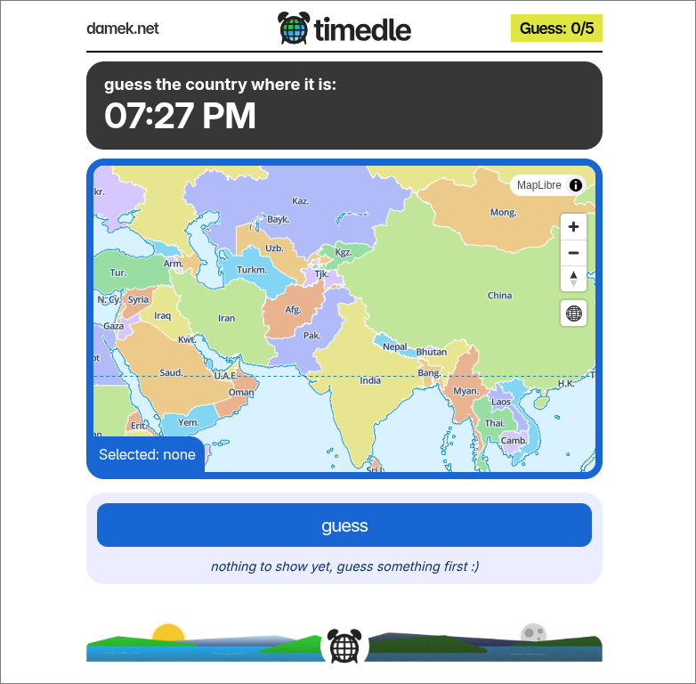
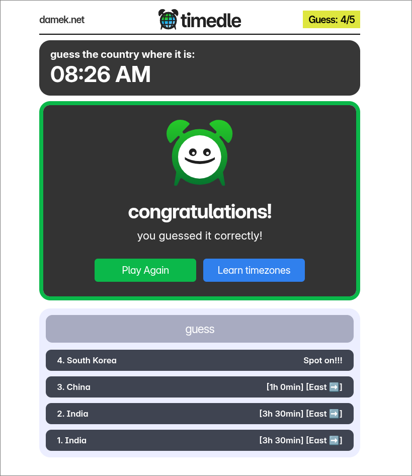
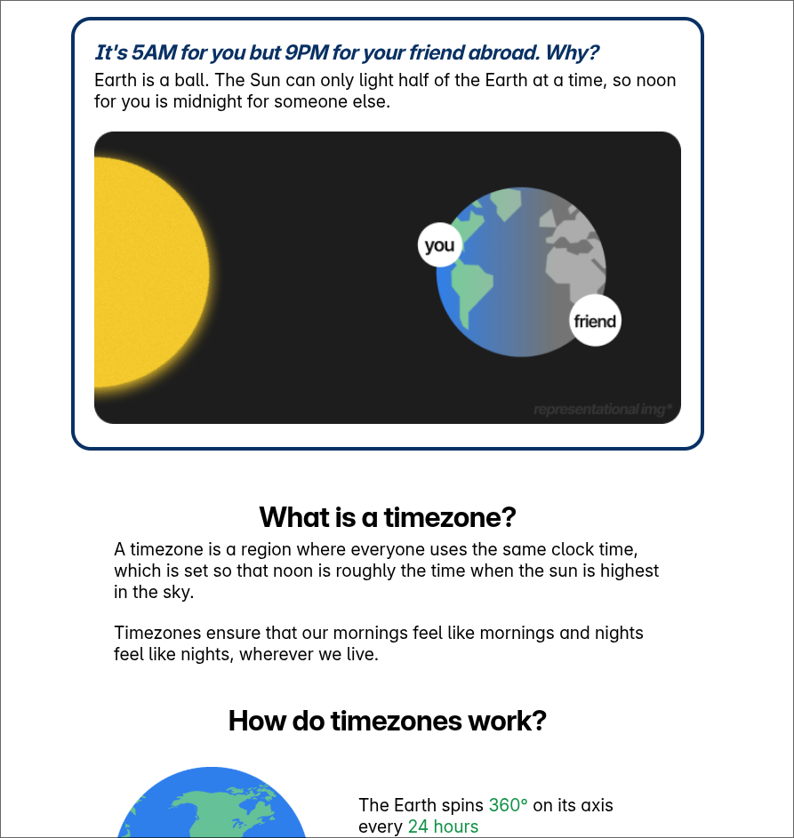
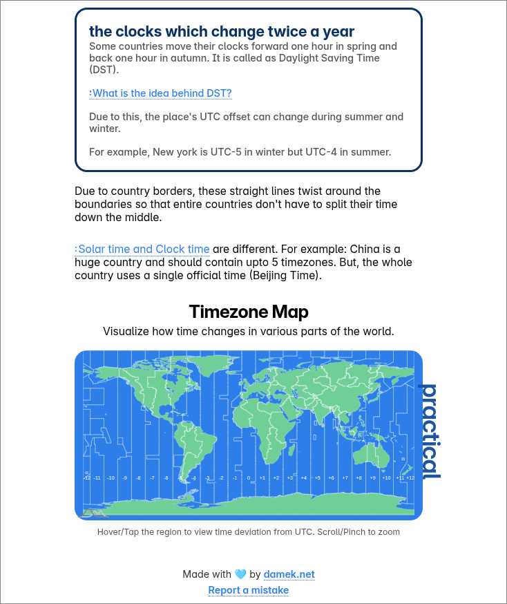
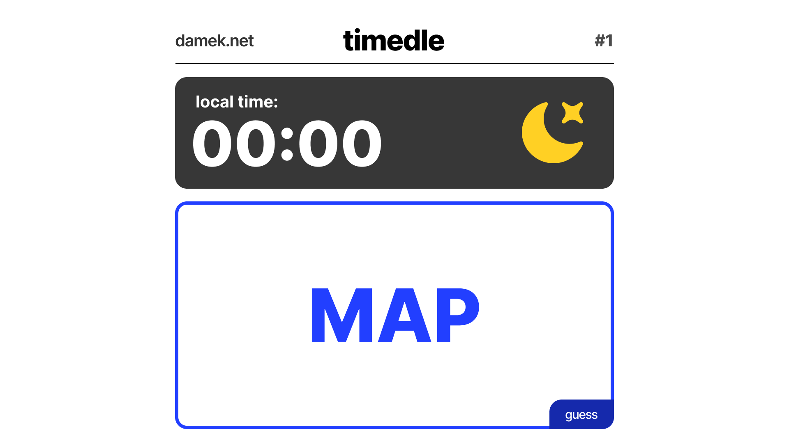

# timedle ⏰

Timedle is a  game in which you have to guess the country by its local time in 5 tries. If you scroll below the game, you might even learn some stuff about timezones ;)

# description

Timedle is a guessing game in which the user has to guess the location/country based on its local time. The user is given 5 tries to guess the location, and is given with hints based on the hour difference of the guessed place and the target place along with east/west direction. The site is not only limited to the game, if scrolled below the game, the user can find [explorable explanations](https://explorabl.es/) styled sections which help the user understand stuff related to timezones and why are they reqruired. 

## Screenshots

# features

- guess the country by clicking on the map, based on the given local time
- teaches what are timezones and why are they needed
- explains about UTC and clock time using theoretical timezone map
- gives information about non-standard timezone offsets and daylight saving time
- interactive practical timezone map which shows timezone offset when hovered/tapped on the region

# tech stack

### frontend and rendering:

- HTML, CSS, JS
- [Nutshell](https://ncase.me/nutshell/) by ncase.me (for explaining complex terms without going out of context on paragraphs)

### mapping, visualization and graphics:

- MapLibre GL JS (the guessing game map)
- AmCharts v5 (interactive practical timezone map)
- Figma (used to design the UI assets and graphics)

### external APIs:

- OpenMeteo API (for timezone detection based on clicked lat/long coorsd)
- Nominatim API (for country names based on clicked lat/long coords)

### local data

- Local json data at `timezone-names.json` from [timezone boundary builder github repo](https://github.com/evansiroky/timezone-boundary-builder/releases/tag/2026c)

# how to play?

Timedle is a web game so it can be accessed and played directly through its website. [click here to play timedle :)](https://damek.net/timedle)

## dependencies

you just need to have **internet access**, a **web browser** installed and *a lot of free time*, to play timedle as it was intended to be played.

# devlogs

Firstly, I designed a basic draft design in Figma.

Using this image as a guide, I started coding a simple website that matches this layout and made it responsive so that the whole UI fits in a normal phone screen without having to scroll.

Then, for adding the map, I used MapLibre because I have used it in one of my [past projects](https://damakerdev.github.io/3d-globe-proj/).

With a working map inside the MAP container, I made it so that when you click on the map, the game logs the coordinates on the console. Then, I used the reverse geocoding api given by bigDataCloud and openMeteo to find out the country name and timezone identifier based on the clicked place on the map.
(the bigDataCloud api hit the limits too quick so switched to nominatim reverse geocoding api -_-)

Then, I made the website load a random timezone when the site loads and show a basic win/lose modal based on, if the user guesses the timezone within 5 tries or less.

After that, I spent most of the time improving the UI and feel of the game and finally made a working version of the game.

But, it felt a bit incomplete so then I added the learn timezones section by sleeping in figma for a long time and going on without touching grass for a week ;-; 

For the timezone map in the learn section, I have used amCharts v5 map editor which is an online map editor where you have to edit the map that you want and can get the code to make the map work in your site. I had to dig deep into its api to learn how to customize it and did quite a bit of customization to finally match the bright blue-green feel there is, in the other graphics.

While designing the learn section, I wanted a way to add meanings to the complex terms without having to go out of context from the paragraphs and thats when I found out about nutshell by ncase.me!! 

---

### Happy Coding!! 🚀